<div align="center">

# TrueNAS Prometheus Exporter

A read-only Prometheus exporter for TrueNAS SCALE. Point it at your NAS, import the bundled Grafana dashboard, and get 400+ metrics without installing anything on TrueNAS itself.


[Quick start](#quick-start) • [Grafana dashboards](#grafana-dashboards) • [Configuration](#configuration) • [Troubleshooting](#troubleshooting)

</div>

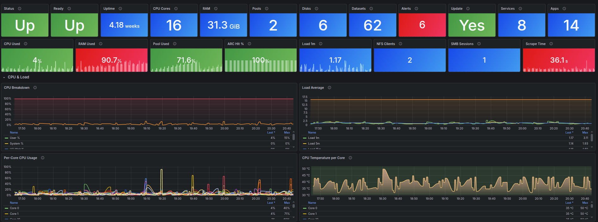

## Overview

This exporter connects to a TrueNAS SCALE system over its JSON-RPC WebSocket API, collects inventory and state data, and serves it as Prometheus metrics on `/metrics`. It runs as a small container (or a plain Python process) alongside your existing Prometheus and Grafana stack.

- **Read-only by design.** Every API method is checked against a documentation-derived allow-list and a mutating-verb deny-list *before* the call is made. The exporter cannot create, modify, or delete anything on your NAS.
- **No agent on TrueNAS.** Nothing is installed on the NAS itself; you only need a read-only API key.
- **Broad coverage.** 400+ metrics spanning pools, datasets, snapshots, disks and temperatures, ZFS ARC, CPU/memory/network, SMB/NFS/iSCSI, apps and Docker, VMs, tasks, alerts, certificates, and UPS.
- **Version-aware.** Detects TrueNAS SCALE `25.10.x` and `26.0.x` from `system.version_short` and selects the correct compatibility profile automatically — no manual toggle.
- **Bundled dashboards.** Two importable Grafana dashboards are included.
- **Hardened defaults.** Ships as a read-only container (`cap_drop: ALL`, `no-new-privileges`) with conservative, low-cardinality collection defaults.

> [!NOTE]
> This project was developed largely with AI assistance against a live home TrueNAS SCALE system and validated against a real `25.10.3` box. It is strictly read-only and follows the official TrueNAS API documentation.

## Quick start

The recommended path is Docker Compose. You will need a TrueNAS SCALE system (`25.10.x` or `26.0.x`) reachable on your network, a host with Docker and Docker Compose, and your NAS's IP or hostname.

### 1. Create a read-only API key on TrueNAS

1. Open the TrueNAS web UI.
2. Open the account menu in the top-right corner and choose **API Keys**. Depending on your version this may instead be under **Settings → API Keys** or **Credentials → Users**.
3. Click **Add** and give the key a name, for example `prometheus-exporter`.
4. If your TrueNAS version supports per-key roles, attach it to an account with a **Read-only** role.
5. Save the key and copy it now — TrueNAS displays it only once.

The exporter never issues anything but read-only calls, so a full-access key is still used safely; scoping the key to a read-only account is defense-in-depth.

### 2. Configure the exporter

From the project directory:

```bash
cp .env.example .env
```

Edit `.env` and set two values:

```dotenv
# Your TrueNAS address with /api/current appended.
# Use wss:// for an HTTPS box (recommended) or ws:// for plain HTTP.
TRUENAS_WS_URL=wss://192.168.1.50/api/current

# The read-only API key from step 1.
TRUENAS_API_KEY=1-your-api-key-here
```

Everything else has a sensible default.

> [!IMPORTANT]
> TrueNAS ships a self-signed certificate by default. If the exporter cannot establish a `wss://` connection, set `TRUENAS_VERIFY_TLS=false` in `.env` for a trusted LAN, or keep verification on and point `TRUENAS_CA_FILE` at your CA bundle.

### 3. Start it

```bash
docker compose up -d --build
```

This builds and runs a hardened container named `truenas-exporter`.

### 4. Verify

```bash
curl http://localhost:9108/healthz     # returns: ok
curl http://localhost:9108/metrics     # returns Prometheus metrics
```

If the metrics output includes `truenas_up 1`, the exporter is connected and scraping.

<details>
<summary>Alternatives: plain Docker image or local Python</summary>

**Docker image**

```bash
cp .env.example .env      # set TRUENAS_WS_URL and TRUENAS_API_KEY
docker pull ghcr.io/unknowlars/truenas-scale-api-prometheus-exporter:latest
docker run --rm --env-file .env -p 9108:9108 \
  ghcr.io/unknowlars/truenas-scale-api-prometheus-exporter:latest
```

**Local Python (3.12+)**

```bash
python3 -m venv .venv
. .venv/bin/activate
pip install -r requirements.txt
cp .env.example .env       # set TRUENAS_WS_URL and TRUENAS_API_KEY
python3 truenas_exporter.py
```

</details>

## Connect Prometheus

Add a scrape job pointing at the exporter, or start from
[`deploy/prometheus/prometheus.truenas-example.yml`](deploy/prometheus/prometheus.truenas-example.yml):

```yaml
scrape_configs:
  - job_name: truenas_exporter
    scrape_interval: 30s
    static_configs:
      - targets:
          - truenas-exporter:9108   # or the exporter host/IP, e.g. 192.168.1.60:9108
```

<details>
<summary>Grafana Alloy instead of a Prometheus scrape config</summary>

```hcl
prometheus.scrape "truenasexporter" {
  targets = [{
    __address__ = "192.168.1.60:9108",
  }]
  forward_to = [prometheus.remote_write.local.receiver]
}
```

Replace the address with your exporter host and port, and point `forward_to` at your existing Alloy `prometheus.remote_write` component. The repo also includes `deploy/prometheus/docker-compose.prometheus.yml` and `deploy/prometheus/prometheus.yml` for local experiments; update their targets before use.

</details>

## Grafana dashboards

Two importable dashboards are included in [`grafana-dashboard/`](grafana-dashboard/):

| Dashboard | File | Requires |
| --- | --- | --- |
| TrueNAS · Mission Control (tabbed, 12 tabs) | `truenas-mission-control.json` | Grafana 13+ (schema v2) |
| TrueNAS Operations Center (classic rows) | `operations-center-dashboard.json` | Any recent Grafana |

To import: in Grafana, go to **Dashboards → New → Import**, upload one of the JSON files, select your Prometheus data source, and import. Make sure Prometheus is already scraping the exporter (see above).

| System and CPU | Memory | Storage and pools |
| --- | --- | --- |
|  | 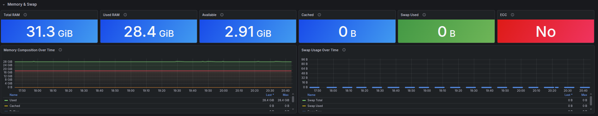 | 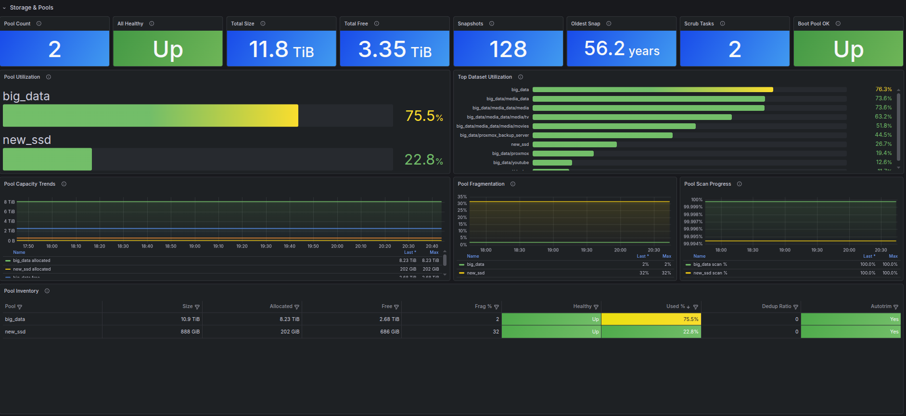 |

| Disks and temperatures | ZFS ARC cache | Network interfaces |
| --- | --- | --- |
| 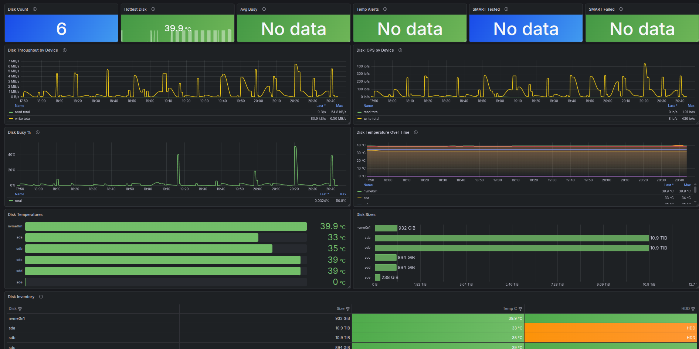 | 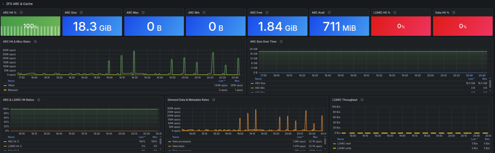 | 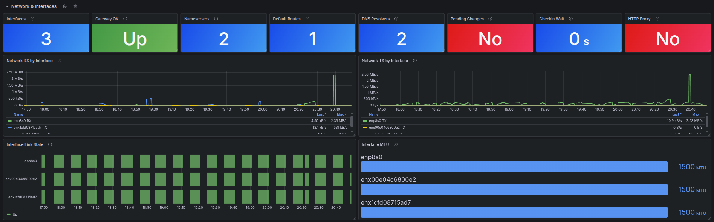 |

| Apps and Docker | Services and shares | Virtualization |
| --- | --- | --- |
| 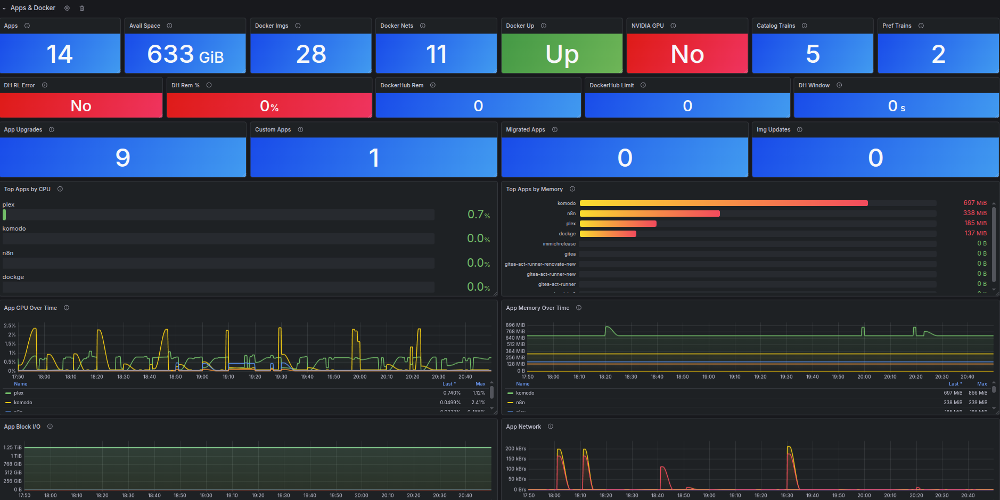 | 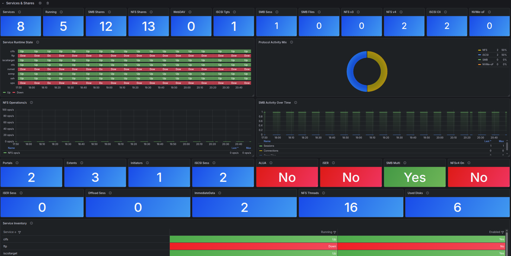 | 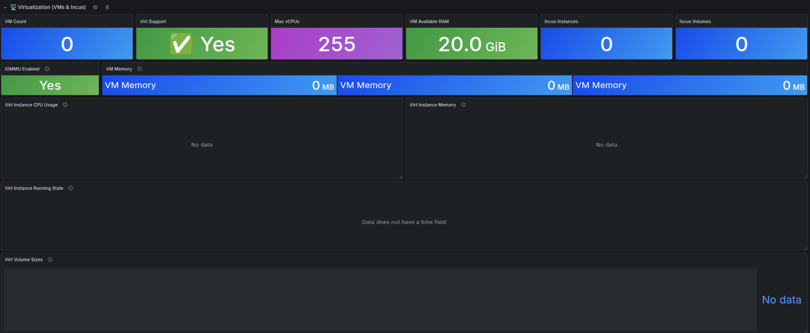 |

<details>
<summary>Remaining dashboard views</summary>

| Storage deep dive | Dataset deep dive |
| --- | --- |
| 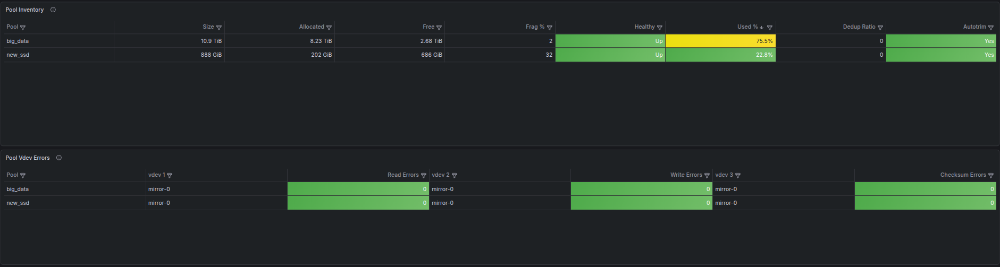 | 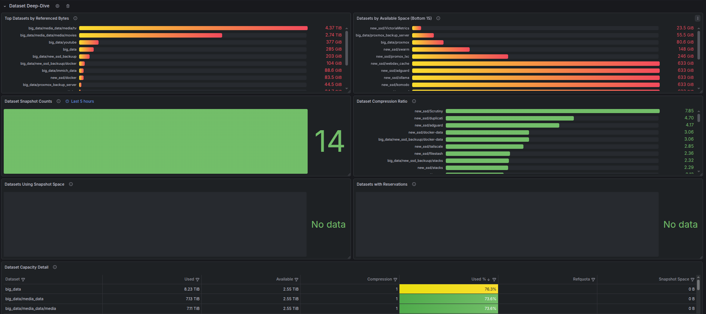 |

| Apps and Docker (details) | Alerts, tasks, and updates |
| --- | --- |
| 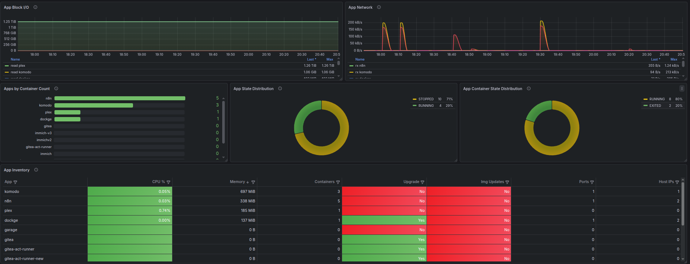 | 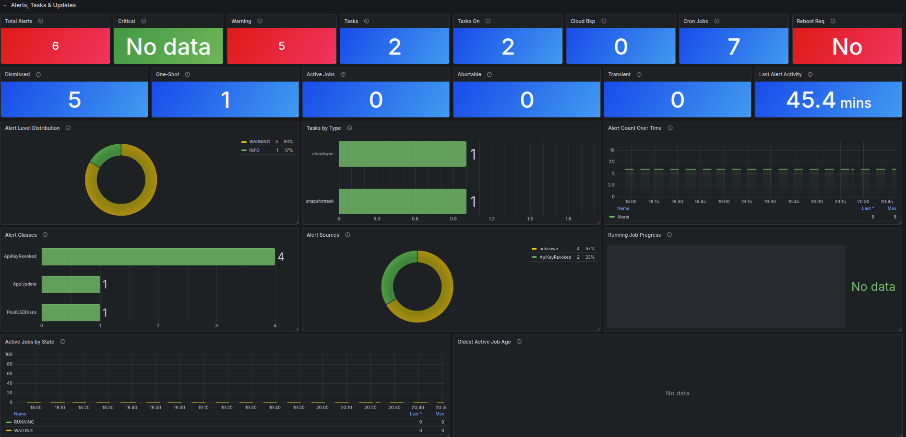 |

| Audit and directory services | Security and platform |
| --- | --- |
| 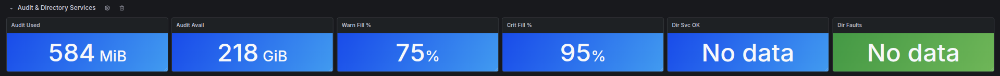 | 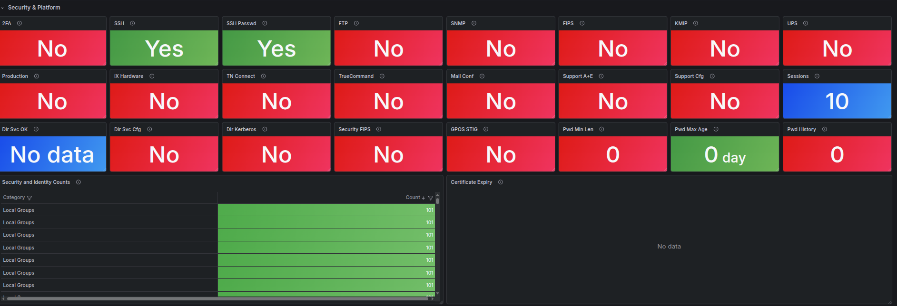 |

| System configuration | Advanced protocols (NVMe-oF, FC, HA) |
| --- | --- |
| 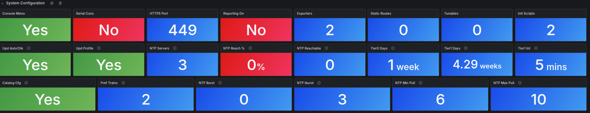 | 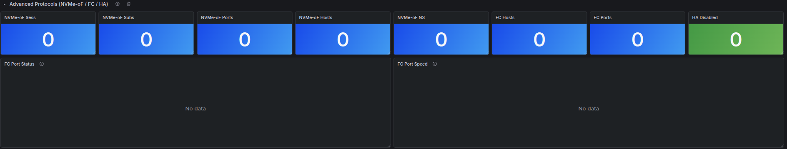 |

| Boot environment | |
| --- | --- |
| 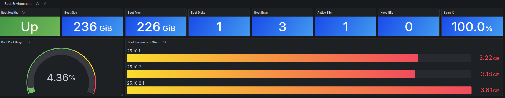 | |

</details>

<details>
<summary>Rebuilding and pushing the Mission Control dashboard</summary>

The Mission Control dashboard is generated code. Edit and re-run `grafana-dashboard/build_mission_control.py` (Python 3, no extra dependencies) rather than hand-editing the JSON. It harvests panel queries from the classic Operations Center dashboard, so query fixes should land there first.

Push it via the Grafana App Platform API:

```bash
curl -X POST -H "Authorization: Bearer $GRAFANA_SA_TOKEN" \
  -H "Content-Type: application/json" \
  --data-binary @grafana-dashboard/truenas-mission-control.json \
  "https://<grafana-host>/apis/dashboard.grafana.app/v2beta1/namespaces/default/dashboards"
```

To update an imported copy, delete the old dashboard and re-import the regenerated JSON (it keeps the same `metadata.name`/URL), or `PUT` it to `/apis/dashboard.grafana.app/v2beta1/namespaces/default/dashboards/truenas-mission-control`.

</details>

## Configuration

Every option is documented with inline comments in [`.env.example`](.env.example). The settings most deployments touch:

| Variable | Required | Default | Description |
| --- | --- | --- | --- |
| `TRUENAS_WS_URL` | yes | — | TrueNAS WebSocket URL, e.g. `wss://192.168.1.50/api/current` |
| `TRUENAS_API_KEY` | yes* | — | Read-only API key (*or provide `TRUENAS_API_KEY_FILE`) |
| `TRUENAS_API_KEY_FILE` | no | — | Path to a mounted file containing the API key (Docker/Kubernetes secrets) |
| `TRUENAS_VERIFY_TLS` | no | `true` | Set `false` only on a trusted LAN with a self-signed certificate |
| `TRUENAS_CA_FILE` | no | — | Path to a custom CA bundle for TLS verification |
| `EXPORTER_PORT` | no | `9108` | HTTP port for `/metrics`, `/healthz`, `/readyz` |
| `SCRAPE_INTERVAL_SECONDS` | no | `30` | Poll interval for collectors |
| `SCRAPE_BUDGET_SECONDS` | no | `25` | Hard deadline for a single scrape |
| `LOG_LEVEL` | no | `INFO` | `DEBUG`, `INFO`, `WARNING`, or `ERROR` |
| `ENABLE_DATASET_METRICS` | no | `true` | Per-dataset space and quota metrics |
| `ENABLE_TASK_METRICS` | no | `true` | Replication, cloudsync, rsync, and snapshot task metrics |
| `ENABLE_IPMI_METRICS` | no | `true` | IPMI chassis and sensor metrics when available |

> [!NOTE]
> Defaults are intentionally conservative and low-cardinality. The high-cardinality options (`ENABLE_GENERIC_METHOD_METRICS`, `ENABLE_GENERIC_EVENT_METRICS`, `AUTO_DISCOVER_METHODS`, `SCRAPE_ALL_METRICS`) are disabled by default and cannot bypass the read-only method policy. See [How it works](#how-it-works) before enabling them.

## Metric coverage

- **System** — identity, version, uptime, readiness, pending updates, reboot state.
- **Storage** — pools, datasets, snapshots, scrub schedules, resilver configuration, expansion progress, capacity, fragmentation, and dedup.
- **Disks** — per-disk I/O rates, busy percentage, and temperatures.
- **Memory and ZFS** — physical memory, ZFS ARC size, and ARC/L2ARC demand hit/miss rates.
- **Sharing and protocols** — SMB, NFS, iSCSI, and NVMe-oF.
- **Workloads** — apps and Docker (including DockerHub pull limits), VMs, jobs, and replication.
- **Health and governance** — alerts, certificates, directory-service health, audit retention, NTP, UPS, and security posture.
- **Exporter self-health** — API call failures, collector error counters, and scrape duration.

## Troubleshooting

| Symptom | Resolution |
| --- | --- |
| Connection or TLS error over `wss://` | Self-signed certificate: set `TRUENAS_VERIFY_TLS=false` on a trusted LAN, or point `TRUENAS_CA_FILE` at your CA. |
| Authentication fails, or `truenas_up 0` | Re-check `TRUENAS_API_KEY` and confirm the URL ends in `/api/current`. |
| Container will not start | Check `docker compose logs -f truenas-exporter`; this is usually a `.env` typo. |
| Some metrics are missing | Many collectors only emit when the related TrueNAS service or subsystem is enabled. This is expected. |
| Metrics flicker to `NaN` in Grafana | Realtime series update between event ticks. Filter them, e.g. `avg((truenas_cpu_user_percent >= 0))`. The Mission Control dashboard already applies this. |

Health endpoints:

- `GET /healthz` — the process is serving HTTP. It does not guarantee the last scrape succeeded.
- `GET /readyz` — returns `200` only after a recent successful scrape, otherwise `503`.

If a metric or API response is missing, [open an issue](https://github.com/Unknowlars/truenas-scale-api-prometheus-exporter/issues) with your TrueNAS version, the relevant config toggles, and the expected result.

## Testing

```bash
python3 -m venv .venv
. .venv/bin/activate
pip install -r requirements-dev.txt
./scripts/validate.sh
```

`validate.sh` runs linting, static typing, branch-covered tests, generated-asset checks, Compose validation, and a container build. Set `RUN_PYTHON_MATRIX=1` to test Python 3.12, 3.13, and 3.14 in local containers. No hosted CI is used by design.

Repository: [`github.com/Unknowlars/truenas-scale-api-prometheus-exporter`](https://github.com/Unknowlars/truenas-scale-api-prometheus-exporter)

## How it works

<details>
<summary>Runtime modes (<code>EXPORTER_MODE</code>)</summary>

<br>

- `collector` (default): a background single-flight scrape publishes complete, atomic snapshots. `/metrics` serves a cached in-memory snapshot (about 10 ms) and never blocks on TrueNAS, which prevents torn reads and keeps the health and readiness endpoints responsive when the NAS is slow.
- `legacy`: the previous global-registry coordinator, retained for the 5.2 release.

`truenas_scrape_duration_seconds` measures the background collection cycle (typically 15–20 s), not HTTP latency, so short Prometheus scrape timeouts are fine.

</details>

<details>
<summary>Version detection and compatibility profiles</summary>

<br>

On every connection the exporter authenticates, calls `system.version_short` once, and selects a profile before any collector call, discovery, or event subscription:

| Detected version | Profile | Behavior |
| --- | --- | --- |
| `25.10.*` | `25.10` | Uses the pinned 25.10.2 audited method and event surface. |
| `26.0.*` | `26.0` | Uses the pinned 26.0.0 surface and suppresses sources removed in v26. |
| Anything else, malformed, or detection failure | `unknown` | Fails closed to the reviewed common intersection only. |

Failed detection never expands API access, and there is no manual version toggle. Sources removed in v26 (`virt.instance.query`, `virt.volume.query`, `reporting.graphs`, `reporting.netdata_graphs`, `virt.instance.metrics`) are suppressed before transport under `26.0` and `unknown`. `nvmet.global.sessions` is absent from the pinned v26 corpus but remains allowed as a bounded count source because live 26.0.0-BETA.2 still serves it.

Default event subscriptions are profile-aware:

| Profile | Default event subscriptions |
| --- | --- |
| `25.10` | `reporting.realtime`, `app.stats`, `virt.instance.metrics` |
| `26.0` / `unknown` | `reporting.realtime`, `app.stats`, `container.metrics` |

</details>

<details>
<summary>Safety model and API parity</summary>

<br>

- **Read-only, enforced before transport.** Every method is checked against a documentation-derived allow-list and a mutating-verb deny-list before the WebSocket call. `AUTO_DISCOVER_METHODS`, `SCRAPE_ALL_METRICS`, and `EXTRA_METHODS` cannot bypass this policy.
- **No fabricated data.** When a metric has no safe source in the active profile, or a response is denied, absent, malformed, or stale, the series is left absent or `NaN` rather than reporting a fake `0`.
- **Secrets suppressed.** Values under password, token, secret, private-key, and credential paths are never emitted, even with generic extraction enabled.
- **Audited, not sampled.** The committed API snapshot inventories 767 methods across 114 namespaces and 63 event sources; see [`docs/api-exporter-parity.md`](docs/api-exporter-parity.md). The pinned 25.10.2/26.0.0 diff is in [`docs/truenas-25-10-2-and-26-0-0-compatibility/`](docs/truenas-25-10-2-and-26-0-0-compatibility/), and the reliability roadmap in [`docs/modernization/README.md`](docs/modernization/README.md).

Existing metric names, types, help text, and label sets are preserved across profiles and releases; replacements ship as compatibility aliases with documented deprecations.

</details>

<details>
<summary>Cardinality and series impact</summary>

<br>

| Option | Default | Impact |
| --- | --- | --- |
| `ENABLE_GENERIC_METHOD_METRICS` | `false` | High — `METHOD_*` series with `[method, path]` labels; 50k–500k+ with discovery. |
| `ENABLE_GENERIC_EVENT_METRICS` | `false` | High — `EVENT_*` series with `[event, path]` labels. |
| `AUTO_DISCOVER_METHODS` | `false` | High — feeds safe, non-sensitive telemetry candidates through generic extraction. |
| `SCRAPE_ALL_METRICS` | `false` | High — adds reviewed telemetry candidates beyond the base set. |
| `DATASET_SNAPSHOT_FALLBACK_LIMIT` | `25` | Medium — up to N extra API calls per scrape for per-dataset snapshot counts. |
| `ENABLE_FILESYSTEM_LISTDIR` | `false` | Medium — per-path directory-listing metrics. |
| `ENABLE_DATASET_METRICS` | `true` | Low–Medium — one gauge set per dataset. |
| `ENABLE_TASK_METRICS` | `true` | Low — one set per configured task. |
| `ENABLE_IPMI_METRICS` | `true` | Low — fixed IPMI sensor set. |

When enabling high-cardinality options, monitor `prometheus_tsdb_head_series` and plan TSDB storage accordingly. Start with the defaults and enable generic extraction only for bounded debugging.

</details>

<details>
<summary>Repository layout</summary>

<br>

| Path | Purpose |
| --- | --- |
| `truenas_exporter.py` | Source-checkout compatibility launcher |
| `src/truenas_exporter/` | Exporter package implementation |
| `Dockerfile`, `docker-compose.yml` | Container image build and deployment |
| `.env.example` | Example environment configuration |
| `deploy/prometheus/` | Example Prometheus scrape configs and compose |
| `grafana-dashboard/*.json` | Importable Grafana dashboards |
| `grafana-dashboard/build_mission_control.py` | Mission Control dashboard builder |
| `scripts/generate_truenas_dashboard.py` | Dashboard generator source |
| `scripts/validate.sh` | Local validation suite |
| `docs/api-exporter-parity.md`, `.json` | Human- and machine-readable API/exporter audit |
| `docs/metrics-contract.json` | Machine-readable Prometheus metric contract |
| `docs/modernization/README.md` | Reliability and architecture roadmap |
| `tests/` | Unit tests for collector and event behavior |

</details>
