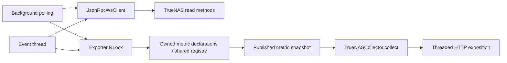

# TrueNAS 27 architecture review

Reviewed 2026-10-19. Initial source reference: `de0e18b`. This report records the
architecture **before the modernization fixes**; line references below refer to
that commit, not moving working-tree line numbers. No appliance calls,
credentials, or live operational responses were used for this review.

## Decision and evidence

Keep the existing package, synchronous WebSocket transport, background polling,
and atomic snapshot exposition. The highest-value changes deepen behavior behind
the existing transport and snapshot interfaces: enforce a complete deadline,
isolate source failures, and enforce event freshness when snapshots are read.
An asynchronous rewrite or per-domain plugin framework would add migration risk
without evidence of a throughput need.

The architecture and codebase-design skills informed this review. The requested
exploration subagent inspected the real source and tests. The user has already
selected the targeted fixes in the accepted modernization plan; another candidate
selection gate is unnecessary. No `GLOSSARY.md` or `docs/adr/` existed at review
start. Existing decisions in `docs/modernization/02-architecture.md` explicitly
favor immutable background snapshots and retain legacy mode for compatibility.

Evidence classes:

- **Confirmed by source:** deterministic control flow or configuration behavior.
- **Confirmed by synthetic reproduction:** an in-memory fake clock/socket or
  mocked transport demonstrates behavior; no NAS was contacted.
- **UNCONFIRMED:** plausible operating risk requiring measurement or live access.

Independent focused validation:

```sh
python3 -m pytest -q -p no:cacheprovider \
  tests/test_transport.py tests/test_reliability.py \
  tests/test_event_stream_liveness.py tests/test_http_integration.py \
  tests/test_phase3_collector_mode.py tests/test_runtime_lifecycle.py
```

Result: **84 passed, 5 skipped**. Five real HTTP tests skipped because the local
sandbox denied socket binding. Pytest also emitted cleanup warnings for unrelated
pre-existing temporary directories; those warnings were not test failures. This
is not a successful real HTTP run. The separately established full baseline was
**257 tests and 91.34% coverage**, with the validation script passing; that result
was supplied by the baseline investigation, not rerun as part of this review.

## Existing design and seams



`TrueNASCollector.collect()` is a useful deep module interface despite its small
implementation: callers receive a complete snapshot and do not perform network
work (`runtime.py:5378-5388`). The HTTP module has a real adapter seam: the
Prometheus registry adapter is used in production and synthetic registry/fake
HTTP adapters are exercised in tests. Deleting this separation would spread
network and concurrency knowledge into HTTP callers.

Metric declarations own stable name/type/HELP/label metadata
(`metrics.py:11-61`), and the contract generator consumes that metadata. The
runtime still writes into the process-global registry and snapshots collected
families. It is effectively a single-exporter-per-process design. This is
acceptable for the deployment contract; multiple exporter instances in one
process are not isolated. Do not add a registry factory solely to make tests
look cleaner.

Both execution modes now use snapshots for HTTP. Their main difference is event
projection and lifecycle plumbing, not a second independent exporter. Preserve
that convergence and test both modes through the public collector interface.

## Ranked changes

Impact and maintenance benefit: high/medium/low. Risk means regression risk of
the proposed change; complexity means implementation effort.

| Rank | Change | Impact | Risk | Complexity | Maintenance benefit | Evidence / acceptance |
| --- | --- | --- | --- | --- | --- | --- |
| 1 | Deepen the transport module so its deadline includes connect, send, and receive | High | Low | Low | High | Confirmed synthetic expired-deadline connection and send; no operation may begin after expiry, and each blocking operation uses remaining time. |
| 2 | Isolate recoverable source failures while preserving failed-cycle health | High | Medium | Medium | High | Confirmed outer exception aborts later domains; later source metrics must survive a missing/forbidden/malformed earlier source in both modes. |
| 3 | Deepen the snapshot module so event TTL is enforced at read time | High | Medium | Medium | High | Confirmed synthetic expired sample survives public snapshot; stale events must disappear/be NaN while polling is blocked, without acquiring its lock. |
| 4 | Preserve structured RPC failure classification and restrict query fallbacks | High | Medium | Low | High | Confirmed every exception triggers a second bare call; parameter incompatibility alone may retry. Transport/authentication failures must terminate. |
| 5 | Add explicit 27 profile and documented optional username authentication | High | Medium | Medium | High | Source currently recognizes 25.10/26.0 only; documentation and fixture verification required, followed separately by live verification. |
| 6 | Bound generic series creation and expose a bounded diagnostic | Medium | Low | Low | Medium | Generic extraction limits list depth/length but traverses every dictionary key; cap applies before materializing series. |
| 7 | Redact credentials and authentication error payloads at the transport seam | High | Low | Low | High | Whole RPC error objects become exception text; host-only traceback redaction does not guarantee secret redaction. Synthetic echo-secret tests required. |
| 8 | Measure polling delay, source duration, and event age under representative scale | Medium | Low | Low | Medium | UNCONFIRMED production scale/lock contention; gather bounded synthetic load evidence before changing concurrency. |
| 9 | Extract a domain parser only when an actual feature needs a shared seam | Low | Medium | Medium | Low | Runtime is large but existing pure parsing module already provides locality; no defect is fixed simply by moving lines. |

The deletion test rejects adding generic collector orchestration, transport
adapter hierarchies, or a second state store merely to split this file. The
current seam already varies meaningfully between real WebSocket and fake socket
adapters. Deepening that implementation offers leverage to polling and event
callers without a new public interface.

## Detailed findings across the requested review areas

| Area | Assessment at baseline | Recommendation and verification |
| --- | --- | --- |
| 1. WebSocket lifecycle | Context-managed close and bounded stray-message loop exist (`transport.py:39-105`). Event cleanup skips unsubscribe on a known dead connection (`runtime.py:2183-2207`). | Keep the lifecycle module. Test close failure, malformed frames, expiry before connect/send, clean stop, dead socket, and reconnect. Do not introduce pooling without measurements. |
| 2. Authentication and recovery | Both connections share `_bootstrap_connection`; authentication accepts broad truthy legacy results (`transport.py:107-122`). No explicit 27 profile exists. | Add documented 27 authentication as an explicit option and accept only its explicit success discriminator. Keep legacy compatibility fixtures. Do not downgrade after rejection or log credentials. Live key behavior remains UNCONFIRMED. |
| 3. Collector responsibilities | Parsing, protocol, configuration, metric declarations, and HTTP are separated. Most domain collection remains in a roughly 5,400-line runtime, including imports. | Improve failure and state locality first. Extract new shared domain behavior only when a real second adapter/caller justifies its seam. File count is not an acceptance measure. |
| 4. Metric registry | `MetricSpec` owns the contract; global gauges/counters populate snapshots. Historic runtime metric re-exports are preserved (`runtime.py:459-464`). | Retain metadata and aliases. Enforce contract checks. Multi-target or multiple instances per process remain unsupported; do not imply registry isolation. |
| 5. Synchronous/asynchronous work | HTTP requests do no middleware work. Polling is serial; an independent event thread shares the exporter lock. | Keep synchronous transport. Deadline and immutable snapshot fixes provide leverage with less risk. Whether async collection would improve production throughput is UNCONFIRMED. |
| 6. Polling/subscriptions | Default generic discovery is off. Known expensive temperature/oldest-snapshot requests are cached for 10 cycles, with 30-cycle maximum staleness (`runtime.py:524-526`, `:4447-4500`, `:4780-4838`). Event reconnection has capped exponential backoff. | Preserve these costs and call deduplication tests. Document effective poll period as work duration plus configured wait (`runtime.py:5370-5375`). Do not infer wall-clock cache TTL from cycle counts. |
| 7. Thread safety | Snapshot lock is short; publication timer acquires polling lock to avoid partial families (`runtime.py:863-899`). Events also acquire polling lock (`:2180`). | Preserve atomic publication and read snapshots without polling lock. Test overlapping reads, timer publication, and blocked polling. Exact production event delay is UNCONFIRMED. |
| 8. Cache freshness | Event freshness is checked during projection under the polling lock, not when reading snapshots (`runtime.py:767-854`). Polled last-known data survives short pre-auth failures with health down and expires after max(3 intervals, 300 seconds). | Publish event timing metadata with families and project TTL at read time. Preserve polled outage behavior. Test independent event expiry and unchanged polling samples. |
| 9. Timeouts/backoff | Deadline limits receive only; connect uses full configured timeout and send precedes the deadline check (`transport.py:51-85`). Broad query fallback duplicates failures (`runtime.py:1083-1097`). | Use remaining time before every blocking operation. Abort promptly for timeout/broken connection/authentication. Retry documented parameter incompatibilities only. Event reconnect backoff (2 to 120 seconds) is adequate absent evidence of synchronized fleet load. |
| 10. Logging/diagnostics | API call duration/success/error and collector-error metrics exist. Host redaction is explicit (`runtime.py:470-495`); many optional failures are debug-only. | Preserve actionable bounded method/source classifications. Sanitize authentication exceptions and avoid raw server payloads. Do not add JSON logging dependencies without an actual ingestion requirement. |
| 11. Configuration | Explicit boolean/integer/mode/URL/address validation, secret-file loading, TLS CA checks, event allowlist, and TTL >= twice interval exist (`config.py:53-177`). | Add only justified options, including optional username and generic series budget. Keep secret values out of errors and examples. Do not silently accept invalid limits. |
| 12. Testability | Existing tests cover lifecycle, stray responses, event teardown, metric contracts, concurrency, and real HTTP with skip-on-sandbox behavior. Expiry test forces private reprojection before collector read. | Test the public transport/collector interfaces so callers and tests cross the same seam. Add integration behavior tests for failure isolation/deadlines/TTL; avoid implementation-mirroring tests and broad parser reshuffling. |
| 13. Dependencies | Two exact runtime dependencies; bounded development ranges and Python >=3.12 in `pyproject.toml`. Baseline dependency audit was reported clean. | Keep runtime dependency count stable. Run the supported Python matrix and audit at release time. Security audit results are time-specific, not proof of future vulnerability absence. |
| 14. Docker | Multi-stage wheel build, slim runtime, non-root UID 10001, read-only Compose filesystem, dropped capabilities, no-new-privileges, and `/healthz` healthcheck exist. Base tag is exact but not digest-pinned. | Preserve controls and validate startup/readiness separately. Image vulnerability status, rootless-host behavior, and resource consumption at scale require distinct checks. Liveness alone does not prove NAS collection readiness. |
| 15. Error isolation | Dedicated helpers often catch failures, but required inline sources share one outer exception (`runtime.py:3453-4048`). Failure at `vm.get_available_memory` or `pool.query` aborts later unrelated domains. | Catch recoverable source failures at a shared collection seam, count them, continue unrelated domains, and preserve failed-cycle health for required sources. Do not treat fatal transport failure as recoverable collector data. |

## Reproduced defects and test gaps

### Complete deadline

An in-memory fake WebSocket with `deadline_monotonic=0` demonstrated **one
connection attempt and one send attempt** before `TimeoutError` was raised.
The receive deadline test in `test_reliability.py` passes while leaving these two
paths uncovered. This is confirmed behavior, not a claim about a slow NAS.

### Public snapshot TTL

With a fake monotonic clock, dispatching synthetic CPU usage `25.0` at time
`100`, publishing once, advancing to `116`, and calling `metric_snapshot()`
still returns `25.0` with a 15-second TTL. Existing expiry tests call private
projection/publication helpers before each read, masking the public-interface
gap. Holding the polling lock can prevent the event thread from refreshing or
expiring that publication. The fix must not require a network call or this lock
in `collect()`.

### Later source suppression

Source inspection and existing
`test_scrape_wipes_polled_metrics_after_bootstrap_before_mid_cycle_failure`
confirm that a mid-cycle failure ends the cycle. There are unguarded inline calls
at `runtime.py:3553` and `:3653`, with one outer `except` at `:4030`. The existing
test correctly verifies stale-data clearing but does not require unrelated later
metrics to survive. Add that requirement without weakening stale-data checks.

## Post-fix verification

The modernization working tree was independently reinspected after the initial
findings. The rows above remain the baseline review; the following ledger records
the resulting targeted changes rather than erasing the original defects.

```sh
python3 -m pytest -q -p no:cacheprovider \
  --basetemp=/tmp/truenas27-architecture-check tests/test_truenas27.py
```

Result: **35 passed in 0.31 seconds**. These are synthetic adapter and collector
tests; none require live middleware or a bound HTTP socket.

| Initial recommendation | Result independently checked | Limits |
| --- | --- | --- |
| Complete transport deadline | `_remaining_timeout()` runs before connection, before send, and before each receive. Expired-budget tests prohibit connection/send and verify the remaining connect timeout. | No live slow-link or appliance timeout claim. WebSocket library/OS behavior remains outside these synthetic checks. |
| Recoverable source isolation | `_source_scope()` classifies known RPC/data failures around required inline sources. Parameterized tests exercise missing/forbidden VM-memory, pool, and interface sources in both modes, preserve later service metrics, and keep `truenas_up=0`. | This tests the documented selected source failures, not every collector and every possible malformed object. Fatal failure still ends the cycle. |
| Snapshot TTL at read time | Published event timestamps accompany families; `metric_snapshot()` projects fresh copies without the polling lock. Tests expire CPU telemetry without republication and complete a public collector read while another thread holds the polling lock. | No live event delivery/reconnection acceptance. Existing lock serialization remains intentional. |
| Classified query fallback | `JsonRpcError` retains structured code; bare-query fallback is restricted to invalid-parameters code `-32602`. A timeout test verifies exactly one attempted query. | Release gate and existing query-shape tests must also remain green. |
| Explicit 27 authentication/profile | Optional username selects documented `API_KEY_PLAIN` through `auth.login_ex`, requiring explicit `SUCCESS`; rejection tests prohibit automatic downgrade. The explicit 27 profile recognizes release/prefixed/RC strings and suppresses removed sources. | Credential roles, exact appliance release, and authentication against that appliance remain unverified. |
| Generic extraction budget | Configuration defaults to 10,000 series separately for polling and event extraction. Current-series and limit-hit diagnostics have bounded `source` labels. Synthetic wide-object and multi-event tests enforce a three-series test limit. | Production cardinality/cost requires representative scale measurement; the cap is a safety limit, not an estimate of expected series. |
| Safe RPC diagnostics | Exception construction omits server message/data fields; a synthetic secret echo in those fields is absent from the exception while its numeric classification remains available. | The transport must also validate the code field before formatting malformed error objects; review feedback flagged this edge for the final hardening pass. |
| Low-cost pool telemetry | `truenas_pool_freeing_bytes` reads the nullable `freeing` field in the existing 26/27 pool query. Tests preserve a real zero, report a positive value, and omit null rather than fabricating a value. | Documentation/fixture-supported, with no added request; live availability remains unverified. |

The fixes deepen existing transport and snapshot interfaces and add a narrow
internal source-execution seam. No asynchronous rewrite, new collector framework,
registry redesign, or additional domain abstraction is needed for these results.

## Remaining acceptance and limits

The final modernization gate must run `./scripts/validate.sh` and record actual
results in `docs/modernization/README.md`. Root-level implementation work owns
that final gate and the post-fix test evidence. Passing synthetic tests does not
establish actual TrueNAS release, API-key permissions, event schemas on the
appliance, live reconnect behavior, or production cardinality. Those remain
explicit live acceptance items.

The companion visual review is generated in `/tmp` rather than committed. It
contains candidate diagrams and no credentials or private telemetry; its exact
path is reported in the execution handoff. It uses CDN styles/diagrams with a
readable static fallback. A browser was not launched in this noninteractive
review environment.
